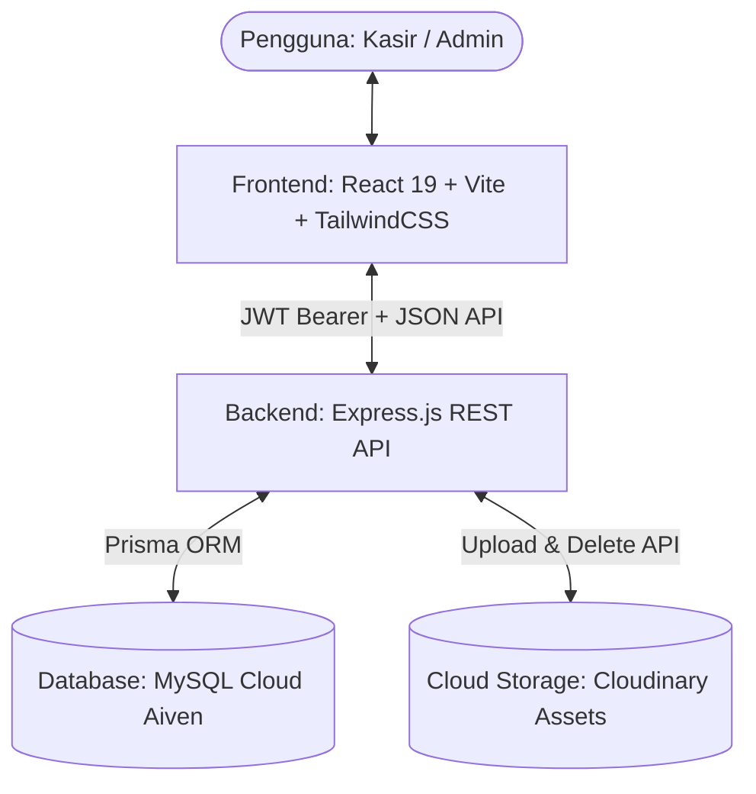
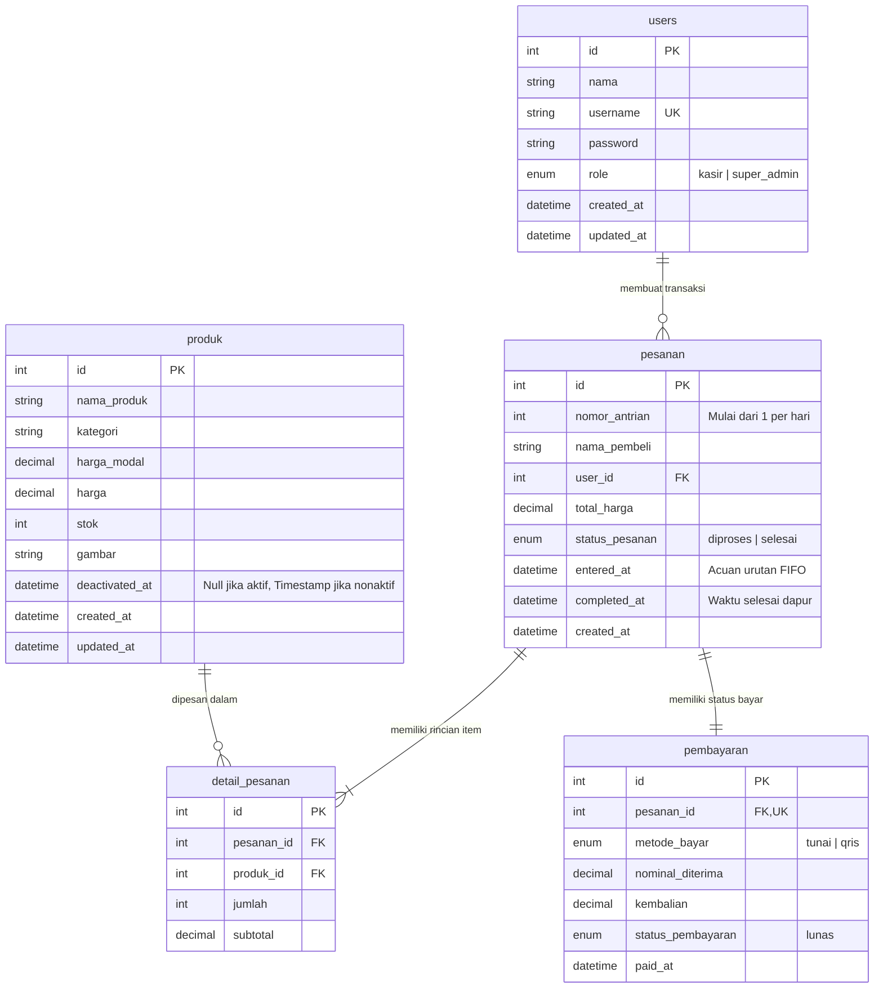
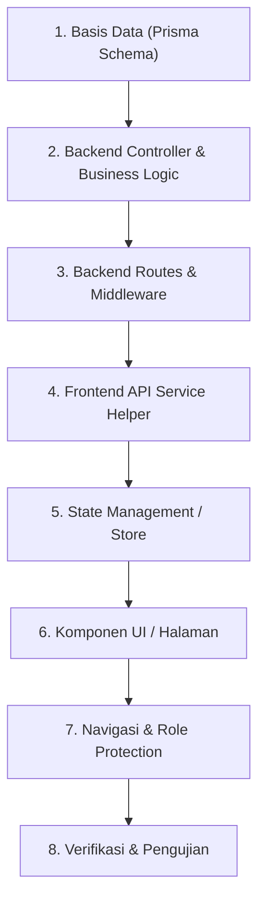

# Master Blueprint & Dokumentasi Arsitektur Kasir Baksoku 🍜

> **Dokumen Panduan Teknis & Arsitektur Sistem**  
> Dibuat untuk memudahkan pengembang/AI dalam memahami alur sistem, struktur kode, skema database, serta menjadi **SOP (Standard Operating Procedure)** resmi saat hendak menambahkan fitur-fitur baru ke dalam aplikasi **Kasir Baksoku**.

---

## 📑 Daftar Isi

1. [Ringkasan Sistem & Profil Bisnis](#1-ringkasan-sistem--profil-bisnis)
2. [Arsitektur & Tech Stack](#2-arsitektur--tech-stack)
3. [Peta Struktur Direktori Proyek](#3-peta-struktur-direktori-proyek)
4. [Skema Basis Data & Model Prisma (ERD)](#4-skema-basis-data--model-prisma-erd)
5. [Spesifikasi & Katalog REST API](#5-spesifikasi--katalog-rest-api)
6. [Logika Bisnis & Alur Operasional Kunci](#6-logika-bisnis--alur-operasional-kunci)
7. [SOP: Panduan Langkah Demi Langkah Menambahkan Fitur Baru](#7-sop-panduan-langkah-demi-langkah-menambahkan-fitur-baru)
8. [Katalog & Rancangan Fitur Baru (Feature Backlog)](#8-katalog--rancangan-fitur-baru-feature-backlog)

---

## 1. Ringkasan Sistem & Profil Bisnis

**Kasir Baksoku** adalah aplikasi kasir (*Point of Sale*) dan manajemen dapur modern yang dirancang khusus untuk operasional kedai bakso. Sistem ini mengintegrasikan pemrosesan transaksi cepat, pengelolaan menu/stok, antrean dapur transparan berbasis **FIFO (First-In-First-Out)**, serta rekapitulasi keuangan harian dan bulanan.

### Hak Akses Pengguna (Multi-Role)
| Peran (Role) | Hak Akses & Menu | Tanggung Jawab Operasional |
|---|---|---|
| **`super_admin`** | Dashboard Statistik, Kasir POS, Monitor Antrean, Kelola Produk, Riwayat Penjualan (Export Excel), Kelola Akun User, Tab Produk Deaktif | Pemilik usaha / manajer toko; mengelola data master, analitik penjualan, dan manajemen kasir. |
| **`kasir`** | Kasir POS, Monitor Antrean Dapur | Operator transaksi harian; melayani pembeli, mencetak struk, dan memantau status pesanan dapur. |

---

## 2. Arsitektur & Tech Stack

Aplikasi menggunakan pola arsitektur **3-Tier / Client-Server Decoupled** (Frontend SPA terpisah dengan RESTful API Backend).



### Rincian Teknologi:
- **Frontend**:
  - Framework: React 19 (Vite bundler)
  - Desain & Styling: Tailwind CSS v4, Lucide React Icons
  - State Management: Zustand (dengan middleware `persist` ke `localStorage`)
  - HTTP Client: Axios (dilengkapi interceptor token JWT otomatis)
  - Grafik & Export: Recharts (visualisasi analitik), SheetJS/xlsx (ekspor laporan)
  - Kapabilitas PWA: `vite-plugin-pwa` (offline support & banner install aplikasi)
- **Backend**:
  - Runtime: Node.js (Express.js)
  - ORM: Prisma ORM v5 (`@prisma/client`)
  - Enkripsi & Token: `bcrypt` (10 salt rounds), `jsonwebtoken` (JWT durasi 24 jam)
  - Manajemen Berkas: `multer` + `multer-storage-cloudinary`
- **Database & Cloud**:
  - Database: MySQL (Aiven Cloud Managed Database dengan SSL connection)
  - Media CDN: Cloudinary untuk penyimpanan foto produk menu bakso & minuman

---

## 3. Peta Struktur Direktori Proyek

```text
Tugas-Proyek/
├── backend/
│   ├── prisma/
│   │   ├── schema.prisma          # Definisi model data, relasi, dan enum Prisma
│   │   └── seed.js                # Data default (akun admin awal & sampel produk)
│   ├── src/
│   │   ├── config/
│   │   │   ├── cloudinary.js      # Konfigurasi integrasi Cloudinary SDK
│   │   │   └── db.js              # Inisialisasi PrismaClient singleton
│   │   ├── controllers/
│   │   │   ├── authController.js     # Logika login, registrasi, CRUD user
│   │   │   ├── pesananController.js  # Transaksi checkout atomik, antrean FIFO
│   │   │   ├── produkController.js   # CRUD produk, upload gambar, soft-delete 30 hari
│   │   │   └── riwayatController.js  # Laporan penjualan, filter tanggal, cetak ulang struk
│   │   ├── middlewares/
│   │   │   ├── authMiddleware.js     # verifyToken & verifyRole(['super_admin', 'kasir'])
│   │   │   └── uploadMiddleware.js   # Parser multer ke Cloudinary
│   │   ├── routes/
│   │   │   ├── auth.routes.js        # /api/auth
│   │   │   ├── pesanan.routes.js     # /api/pesanan
│   │   │   ├── produk.routes.js      # /api/produk
│   │   │   └── riwayat.routes.js     # /api/riwayat
│   │   └── server.js                 # Express server root & middleware bootstrap
│   ├── package.json
│   └── .env                          # DATABASE_URL, JWT_SECRET, CLOUDINARY_URL
├── frontend/
│   ├── public/                       # Manifest PWA, favicon, logo
│   ├── src/
│   │   ├── components/
│   │   │   ├── AdminLayout.jsx       # Layout pembungkus utama (sidebar + content container)
│   │   │   ├── Sidebar.jsx           # Navigasi responsif (sidebar desktop & bottom-nav mobile)
│   │   │   ├── Struk.jsx             # Template cetak struk kasir (thermal receipt 58mm/80mm)
│   │   │   ├── RekapStruk.jsx        # Template cetak ringkasan rekapitulasi harian
│   │   │   ├── PWAInstallBanner.jsx  # Prompt install aplikasi web ke desktop/mobile
│   │   │   └── ui/                   # Komponen atomik: Button, Input, Modal, Table
│   │   ├── pages/
│   │   │   ├── Login.jsx             # Halaman autentikasi login
│   │   │   ├── Dashboard.jsx         # Dasbor metrik penjualan & grafik (Khusus Admin)
│   │   │   ├── InputPesanan.jsx      # Layar kasir POS (katalog produk, keranjang, pembayaran)
│   │   │   ├── MonitorAntrian.jsx    # Layar monitor antrean dapur waktu-nyata (FIFO)
│   │   │   ├── KelolaProduk.jsx      # Manajemen katalog produk & stok menu
│   │   │   ├── ProdukDeaktif.jsx     # Tab pemulihan produk yang dinonaktifkan (arsip 30 hari)
│   │   │   ├── RiwayatPenjualan.jsx  # Riwayat transaksi, filter rentang tanggal, cetak & ekspor
│   │   │   └── KelolaUser.jsx        # Manajemen akun kasir dan administrator
│   │   ├── services/
│   │   │   ├── api.js                # Instance Axios + Authorization Interceptor
│   │   │   └── pwaService.js         # Service worker & pwa caching logic
│   │   ├── store/
│   │   │   └── authStore.js          # Zustand store (token, profil pengguna, persist)
│   │   ├── App.jsx                   # Pemetaan rute React Router & Role Guards
│   │   └── main.jsx                  # React DOM mount point
│   └── package.json
├── docs/                             # Dokumen perencanaan, diagram, dan analisis teknis
├── DOKUMENTASI_APLIKASI.md           # Master blueprint teknis (File ini)
└── README.md                         # Panduan pengenalan & instruksi instalasi umum
```

---

## 4. Skema Basis Data & Model Prisma (ERD)

Database menggunakan **MySQL** yang dimodelkan menggunakan **Prisma ORM**.



### Catatan Model & Integritas:
- **`Produk.deactivatedAt`**: Mengimplementasikan pola *soft-delete*. Jika diisi tanggal, produk disembunyikan dari POS dan katalog aktif, namun riwayat transaksi lama pada `detail_pesanan` tetap aman dan valid (*referential integrity* terjaga).
- **`Pesanan.enteredAt`**: Menjadi kunci algoritma **FIFO (First-In-First-Out)** di dapur (`ORDER BY enteredAt ASC`).
- **`User.pesanan`**: Jika akun kasir memiliki riwayat pesanan, sistem memproteksi akun tersebut dari penghapusan permanen demi konsistensi laporan audit keuangan.

---

## 5. Spesifikasi & Katalog REST API

Semua endpoint dilindungi oleh `verifyToken` kecuali yang bertanda `[Publik]`. Request yang membutuhkan login harus menyertakan header:
```http
Authorization: Bearer <token_jwt>
```

### 5.1 Modul Autentikasi & Akun (`/api/auth`)
| Method | Endpoint | Hak Akses | Deskripsi & Payload |
|---|---|---|---|
| `POST` | `/api/auth/login` | Publik | **Login Pengguna**.<br>Body: `{ username, password }`<br>Response: `{ token, user: { id, nama, username, role } }` |
| `POST` | `/api/auth/register` | Super Admin | **Mendaftarkan Akun Baru**.<br>Body: `{ nama, username, password, role }` |
| `GET` | `/api/auth/users` | Super Admin | **Daftar Seluruh Pengguna** (Kasir & Admin). |
| `PUT` | `/api/auth/users/:id` | Super Admin | **Perbarui Akun** (Nama, Username, Password, Role). |
| `DELETE`| `/api/auth/users/:id` | Super Admin | **Hapus Akun** (Diproteksi jika memiliki riwayat pesanan). |

### 5.2 Modul Produk & Menu (`/api/produk`)
| Method | Endpoint | Hak Akses | Deskripsi & Payload |
|---|---|---|---|
| `GET` | `/api/produk` | Publik, Kasir & Admin | **Ambil Produk Aktif** (`deactivatedAt: null`). Menampilkan menu dan ketersediaan stok real-time untuk pemesanan online maupun kasir POS. |
| `GET` | `/api/produk/deactivated` | Super Admin | **Ambil Produk Nonaktif** (Tab Arsip Pemulihan 30 Hari). |
| `POST` | `/api/produk` | Super Admin | **Tambah Menu Baru**.<br>Form-Data: `namaProduk`, `harga`, `hargaModal`, `stok`, `kategori`, `gambar` (opsional). |
| `PUT` | `/api/produk/:id` | Super Admin | **Update Menu**.<br>Form-Data: properti yang diubah + `gambar` baru atau `removeImage: "true"`. |
| `DELETE`| `/api/produk/:id` | Super Admin | **Nonaktifkan Menu (Soft-Delete 30 Hari)**.<br>Mengisi `deactivatedAt = new Date()`. |
| `POST` | `/api/produk/:id/restore` | Super Admin | **Pulihkan Menu**.<br>Mengatur `deactivatedAt = null`. |

### 5.3 Modul Pesanan, Antrean FIFO & Order Online (`/api/pesanan`)
| Method | Endpoint | Hak Akses | Deskripsi & Payload |
|---|---|---|---|
| `POST` | `/api/pesanan/online` | Publik (Pelanggan) | **Transaksi Order Online Mandiri**.<br>Body: `{ namaPembeli, nomorHp, items: [{ produkId, jumlah }] }`.<br>Menghitung nomor antrian hari ini, memotong stok, membuat pembayaran QRIS lunas secara atomik via Prisma `$transaction`. |
| `GET` | `/api/pesanan/status/:id` | Publik (Pelanggan) | **Cek Status Tiket Antrean Online**.<br>Mengambil detail pesanan dan status kesiapan dapur. |
| `POST` | `/api/pesanan` | Kasir & Admin | **Buat Transaksi Kasir (Checkout POS)**.<br>Body:<br>```json
{
  "namaPembeli": "Budi",
  "metodeBayar": "tunai",
  "nominalDiterima": 50000,
  "items": [
    { "produkId": 1, "jumlah": 2 }
  ]
}
```<br>Menghitung nomor antrian hari ini, memotong stok, membuat `pembayaran` lunas via Prisma `$transaction`. |
| `GET` | `/api/pesanan/antrian` | Kasir & Admin | **Daftar Antrean Dapur Aktif**.<br>Hanya mengambil `statusPesanan: "diproses"`, diurutkan secara **FIFO** (`ORDER BY enteredAt ASC`). Dilengkapi badge Order Online dan nomor WhatsApp pelanggan. |
| `PUT` | `/api/pesanan/:id/status` | Kasir & Admin | **Selesaikan Pesanan Dapur & Notifikasi WA**.<br>Mengubah `statusPesanan = "selesai"`, mengisi `completedAt = new Date()`, dan memicu opsi kirim notifikasi WhatsApp ke pelanggan. |

### 5.4 Modul Riwayat & Rekap Penjualan (`/api/riwayat`)
| Method | Endpoint | Hak Akses | Deskripsi & Payload |
|---|---|---|---|
| `GET` | `/api/riwayat` | Super Admin | **Riwayat Transaksi Lengkap**.<br>Query Params: `?startDate=YYYY-MM-DD&endDate=YYYY-MM-DD&metodeBayar=tunai` |
| `GET` | `/api/riwayat/:id` | Super Admin | **Detail Pesanan & Item Pembelian**. |
| `GET` | `/api/riwayat/:id/struk` | Super Admin | **Ambil Format Data Cetak Struk Ulang**. |

---

## 6. Logika Bisnis & Alur Operasional Kunci

### 6.1 Transaksi Kasir Atomik (ACID via Prisma `$transaction`)
Saat kasir mengonfirmasi pembayaran di layar POS:
1. **Validasi Ketersediaan**: Sistem mengambil seluruh produk dalam keranjang via query tunggal (`in: productIds`) untuk mencegah masalah performa *N+1*. Memverifikasi apakah `stok >= item.jumlah`.
2. **Penentuan Nomor Antrean**: Query pesanan terakhir yang dibuat pada hari ini (`createdAt >= startOfToday 00:00:00`).
   - Jika belum ada pesanan hari ini: `nomorAntrian = 1`.
   - Jika sudah ada: `nomorAntrian = lastPesanan.nomorAntrian + 1`.
3. **Eksekusi Atomik**: Melalui `prisma.$transaction`:
   - Simpan entri `pesanan`.
   - Simpan rincian `detailPesanan`.
   - Simpan bukti pembayaran di `pembayaran` (`nominalDiterima`, `kembalian`).
   - Kurangi stok produk secara paralel (`stok: { decrement: item.jumlah }`).
   - Jika salah satu langkah gagal, seluruh mutasi dibatalkan otomatis (*rollback*).

### 6.2 Alur Antrean Dapur Waktu-Nyata (Metode FIFO)
1. Pesanan baru otomatis memiliki `statusPesanan: 'diproses'` dan `enteredAt: now()`.
2. Halaman **Monitor Antrian** memuat pesanan aktif dengan kriteria:
   ```javascript
   prisma.pesanan.findMany({
     where: { statusPesanan: 'diproses' },
     orderBy: { enteredAt: 'asc' } // First-In, First-Out
   });
   ```
3. Tim dapur melihat daftar pesanan tersusun rapi dari kiri-ke-kanan sesuai urutan pelanggan yang memesan lebih awal.
4. Ketika masakan selesai disiapkan dan diserahkan ke pelanggan, tombol **"Selesaikan Pesanan"** ditekan, mengubah status menjadi `selesai` dan mengisi `completedAt`.

### 6.3 Siklus Deaktivasi Menu 30 Hari & Cloudinary Purge
Untuk menghindari penghapusan menu yang menyebabkan laporan penjualan historis rusak:
1. Menghapus menu hanya akan menandai kolom `deactivatedAt`.
2. Menu masuk ke tab **Produk Deaktif** selama 30 hari (bisa di-*restore* kapan saja).
3. Setelah 30 hari, fungsi pembersih otomatis (*background cleanup*) akan mencoba menghapus baris produk dan menghapus aset gambar dari Cloudinary jika produk tidak terikat ke transaksi lampau.

---

## 7. SOP: Panduan Langkah Demi Langkah Menambahkan Fitur Baru

Gunakan daftar periksa (*checklist*) standar di bawah ini setiap kali Anda akan menambahkan fitur baru ke dalam aplikasi:



### Langkah 1: Modifikasi Basis Data (Prisma Schema)
1. Buka [schema.prisma](file:///c:/Users/Umar/Desktop/Tugas-Proyek/backend/prisma/schema.prisma).
2. Tambahkan model baru atau tambahkan kolom baru pada model yang sudah ada.
3. Sinkronkan skema ke database MySQL:
   ```bash
   cd backend
   npx prisma db push
   npx prisma generate
   ```

### Langkah 2: Logika Bisnis & Controller Backend
1. Buat atau perbarui file controller di `backend/src/controllers/` (contoh: `logController.js` atau tambahkan fungsi di controller terkait).
2. Lakukan validasi input request (`req.body` / `req.query`).
3. Gunakan `prisma.<model>` untuk operasi basis data.
4. Tangani error handling dengan blok `try-catch` dan kembalikan kode status HTTP yang tepat (`200`, `201`, `400`, `404`, `500`).

### Langkah 3: Rute & Otorisasi Backend
1. Daftarkan endpoint di `backend/src/routes/`.
2. Gunakan middleware `verifyToken` untuk otentikasi.
3. Gunakan middleware `verifyRole(['super_admin'])` jika rute bersifat privat/eksklusif.
4. Daftarkan rute di [server.js](file:///c:/Users/Umar/Desktop/Tugas-Proyek/backend/src/server.js).

### Langkah 4: Integrasi Frontend API Service
1. Manfaatkan [api.js](file:///c:/Users/Umar/Desktop/Tugas-Proyek/frontend/src/services/api.js) untuk memanggil backend.
2. Token JWT otomatis disematkan pada setiap request via Axios interceptor.
3. Siapkan penanganan respon sukses dan pesan error.

### Langkah 5: Pembuatan Komponen UI & Halaman Frontend
1. Buat halaman baru di `frontend/src/pages/` atau komponen di `frontend/src/components/`.
2. Gunakan styling Tailwind CSS yang serasi dengan tema desain yang sudah ada (warna primer hijau/emerald, kartu putih rounded-2xl, ikon Lucide React).
3. Sediakan status loading (*skeleton/spinner*) dan umpan balik aksi (*modal/toast konfirmasi*).

### Langkah 6: Routing & Navigasi Sidebar
1. Buka [App.jsx](file:///c:/Users/Umar/Desktop/Tugas-Proyek/frontend/src/App.jsx), daftarkan rute baru menggunakan `<ProtectedRoute allowedRoles={[...]}>`.
2. Buka [Sidebar.jsx](file:///c:/Users/Umar/Desktop/Tugas-Proyek/frontend/src/components/Sidebar.jsx), tambahkan item menu pada `adminLinks` atau `kasirLinks` beserta ikon Lucide yang representatif.

### Langkah 7: Pengujian & Validasi
1. Uji menggunakan akun **Super Admin** (`admin / admin123`).
2. Uji menggunakan akun **Kasir** (`kasir / kasir123`).
3. Pastikan tidak terjadi regresi pada fungsi pencatatan pesanan, pemotongan stok, atau cetak struk.

---

## 8. Katalog & Rancangan Fitur Baru (Feature Backlog)

Berikut adalah daftar fitur potensial yang telah dirancang dan siap untuk diimplementasikan ke dalam aplikasi:

### 🌟 Fitur 1: Modul Audit Log / Log Aktivitas Detail
- **Tujuan**: Mencatat seluruh aktivitas sensitif demi transparansi operasional toko (siapa melakukan apa, kapan, dan dari IP mana).
- **Aktivitas yang Dicatat**:
  - Autentikasi (login sukses/gagal, logout).
  - Manajemen produk (tambah produk, edit harga/stok, soft delete, restore).
  - Transaksi POS (pembuatan pesanan baru, penyelesaian antrean dapur).
  - Manajemen user (tambah akun kasir, ubah sandi, hapus kasir).
- **Spesifikasi Database**: Tabel `activity_logs` (`userId`, `username`, `action`, `description`, `ipAddress`, `createdAt`).
- **Dokumen Rancangan Lengkap**: [rancangan_log_aktivitas.md](file:///c:/Users/Umar/Desktop/Tugas-Proyek/docs/rancangan_log_aktivitas.md).

### 🍲 Fitur 2: Sistem Meja & Tipe Pemesanan (Dine-In vs Take-Away)
- **Tujuan**: Memisahkan pesanan makan di tempat (Dine-In dengan Nomor Meja) dan pesanan bungkus bawa pulang (Take-Away).
- **Perubahan Data**:
  - Kolom `tipePesanan` (`dine_in`, `take_away`) pada tabel `pesanan`.
  - Kolom `nomorMeja` (opsional jika Dine-In) pada tabel `pesanan`.
- **Dampak UI**: Kasir memilih tombol toggle "Makan di Tempat / Bungkus" dan input nomor meja di modal checkout; nomor meja tampil jelas pada struk dan layar monitor dapur.

### 🏷️ Fitur 3: Diskon, Promo & Kupon Potongan Harga
- **Tujuan**: Memberikan diskon belanja dalam bentuk nominal (Rp) atau persentase (%).
- **Perubahan Data**:
  - Kolom `diskonNominal` (Decimal) pada tabel `pesanan`.
  - Kolom `catatanDiskon` (String) untuk keterangan promo (misal: "Promo Jumat Berkah").
- **Dampak UI**: Input diskon di keranjang POS kasir yang secara dinamis memotong total tagihan dan tertera di rincian struk belanja.

### 🔔 Fitur 4: Panggilan Suara Antrean Dapur (Voice/Sound Announcement)
- **Tujuan**: Membunyikan suara notifikasi lonceng atau panggilan suara otomatis (Text-to-Speech) saat pesanan selesai disiapkan.
- **Implementasi**: Menggunakan browser Web Speech API (`window.speechSynthesis`) di halaman Monitor Antrian:
  ```javascript
  const announceOrder = (nomorAntrian, nama) => {
    const speech = new SpeechSynthesisUtterance(`Pesanan nomor ${nomorAntrian} atas nama ${nama}, siap diambil.`);
    speech.lang = 'id-ID';
    window.speechSynthesis.speak(speech);
  };
  ```

### 📦 Fitur 5: Manajemen Bahan Baku & Komposisi Menu (Inventory Raw Materials)
- **Tujuan**: Memantau stok bahan mentah (daging giling, mie kuning, bihun, pangsit, kuah kaldu) yang berkurang otomatis saat seporsi bakso dipesan.
- **Perubahan Data**: Tabel `bahan_baku` dan relasi Many-to-Many `komposisi_produk`.

### 💳 Fitur 6: QRIS Dinamis & Multi-Metode Pembayaran
- **Tujuan**: Menambahkan opsi pembayaran transfer bank/debit serta integrasi QRIS dinamis yang otomatis terverifikasi.

---

## 9. Perintah Penting (Cheat Sheet Terminal)

```bash
# Menjalankan Backend (Port 5000)
cd backend
npm run dev

# Menjalankan Frontend (Port 5173 / 5174)
cd frontend
npm run dev

# Pembaruan Skema Basis Data MySQL
cd backend
npx prisma db push
npx prisma generate
npx prisma db seed

# Membuka Prisma Studio (Web GUI Database Explorer)
cd backend
npx prisma studio
```

---
*Dokumentasi ini merupakan referensi resmi arsitektur sistem Kasir Baksoku. Selalu perbarui dokumen ini setiap kali terdapat perubahan arsitektur data atau rute API baru.*
